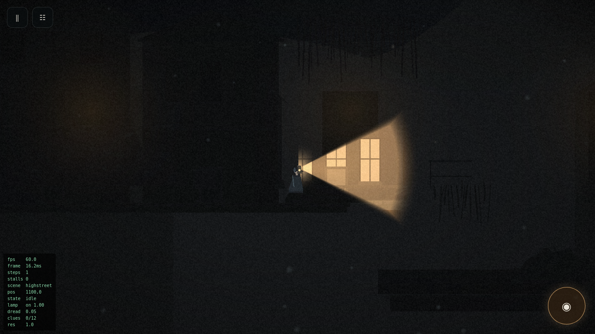

# What the Water Kept

A side-view, cinematic horror-mystery for Android. You are a hydrographic
surveyor sent to a reservoir that has just been drained for inspection, and the
village under it is your mother's.

Plays entirely offline. No account, no server, no network permission.

---

## The game

**Genre** — side-view exploration, investigation and environmental horror
**Length** — about 25–35 minutes for a first playthrough
**Chapters** — six connected locations in one drowned valley
**Controls** — landscape, touch, two thumbs

### The premise

In April 1964 the Corran Valley was flooded to make a reservoir. The village of
Corran Mill went under, and so did nineteen people in its low town who were
never told to leave. Sixty-one years later the water is drawn down for a dam
inspection, and Wren Calloway is sent to survey the silt.

She took the job because her mother has never once said the word *Corran*.

### The lantern

In the silt at the foot of the intake tower, Wren finds a brass survey lamp
left by the 1964 crew. Its light does not illuminate the ruins.

**Inside the beam, the valley is as it was on the night of the flood.**

Three rules, and the game never breaks them:

1. **What the beam shows is really there.** A collapsed footbridge is a bridge
   while you keep it lit, and you can walk across it. Take the light off it and
   you are standing on 1964.
2. **The Drowned exist only in the Before.** They are invisible and
   motionless in darkness.
3. **Lighting one is what lets it see you.**

So the lamp is simultaneously the only way forward and the only thing that can
get you killed, and every puzzle in the game is a negotiation between those two
facts.



---

## Technology

No game engine. The brief for this project ruled out Godot, Unity, Unreal,
GameMaker, Construct, Phaser and Cocos, so every gameplay system here is
written directly in TypeScript.

| Layer | Choice |
| --- | --- |
| Language | TypeScript 5.7, strict |
| Bundler | Vite 6 |
| Rendering | PixiJS 8 (a GPU-accelerated 2D renderer, not an engine) |
| Audio | Web Audio API — every sound synthesised at runtime |
| Art | Procedural vector illustration — no image files at all |
| Persistence | IndexedDB, with a localStorage fallback |
| Packaging | Capacitor 7 → Android |
| Tests | Vitest, plus a Selenium browser smoke test |

### No binary assets

The game ships with **no textures, no sprite sheets and no audio files**. Every
texture is generated from a 2D canvas at startup, every character is a bone
rig drawn with vector graphics, and every sound is synthesised from oscillators
and filtered noise.

That is not a stunt. It means nothing can fail to load, the APK is 3.5 MB, and
the offline requirement is satisfied by construction rather than by careful
packaging. The only binary files in the bundle are two open-licensed fonts.

---

## Project structure

```
src/
├── app/          Application shell: PixiJS setup, loop, UI wiring, saving
├── core/         Maths, RNG, event bus, fixed-timestep loop, state machines
├── rendering/    Parallax scene view, lighting, camera, particles, props
│   └── props/    The procedural art library (43 parameterised props)
├── player/       Locomotion state machine, movement tuning, the lantern
├── physics/      AABB collision with light-dependent geometry
├── world/        Scene data model and authoring helpers
├── scenes/       The six chapters, as data
├── gameplay/     Director, cone geometry, the Drowned, cinematics, game state
├── puzzles/      Four puzzle implementations with explicit contracts
├── narrative/    All text and the clue journal
├── audio/        Synthesiser, ambience beds, mixer
├── input/        Touch and keyboard
├── ui/           DOM interface: HUD, screens, narration
├── persistence/  Save schema, validation, migration, IndexedDB store
└── mobile/       Capacitor lifecycle, orientation, safe areas
```

Further reading:

- [`GAME_DESIGN.md`](GAME_DESIGN.md) — story, mechanics, puzzles, horror design
- [`ARCHITECTURE.md`](ARCHITECTURE.md) — how the engine fits together
- [`BUILD.md`](BUILD.md) — toolchain, build commands, signing
- [`TEST_REPORT.md`](TEST_REPORT.md) — what was tested, what was not
- [`DEVELOPMENT_LOG.md`](DEVELOPMENT_LOG.md) — decisions and notable fixes

---

## Running it

### Play the built APK

```sh
adb install -r release/what-the-water-kept.apk
```

Or copy the APK to a device and open it. You will need to allow installation
from unknown sources; the APK is signed with a locally generated key, not a
Play Store key.

It has been installed and played on an Android 14 emulator in airplane mode.
It has **not** been run on physical hardware — see
[`TEST_REPORT.md`](TEST_REPORT.md).

### Development

Requires Node 20+.

```sh
npm install
npm run dev        # http://localhost:5173
```

Desktop controls: **arrows/WASD** move, **Shift** run, **Ctrl/C** crouch,
**Space/F** lantern, **E/Enter** interact, **J/Tab** journal, **Esc** pause,
**F3** performance overlay.

### Checks

```sh
npm run typecheck      # tsc --noEmit, strict
npm test               # 177 unit, logic and level-audit tests
npm run build          # typecheck + production bundle
node tools/smoke.mjs   # drives the real build in Firefox (see BUILD.md)
```

### Android

```sh
npm run build
npx cap sync android
cd android && ./gradlew assembleRelease
```

See [`BUILD.md`](BUILD.md) for the toolchain versions, environment variables
and signing configuration.

### iOS

The codebase is platform-neutral and uses no Android-specific APIs, so an iOS
target is a `npx cap add ios` away — but it has **not** been built or tested,
because that requires macOS and Xcode. See BUILD.md for what remains.

---

## Playing

- **Left half of the screen** is a floating thumbstick. Push it further to run,
  pull it down to crouch. There are no run or crouch buttons.
- **Lantern** is the large round button, bottom right.
- **Context button** appears only when there is something to do.
- Progress saves at every checkpoint and when the app is backgrounded.

If something is about to kill you, the answer is almost always to turn the
lamp off and stand still.

---

## Credits and licences

Written, designed, illustrated and built autonomously in Claude Code.

Typography: **EB Garamond** and **Inter**, both under the SIL Open Font
License 1.1, bundled locally.

Corran Mill is invented, but the drowned villages of Mardale Green, Capel
Celyn, Derwent and Ashopton are not, and this game owes them its premise.
